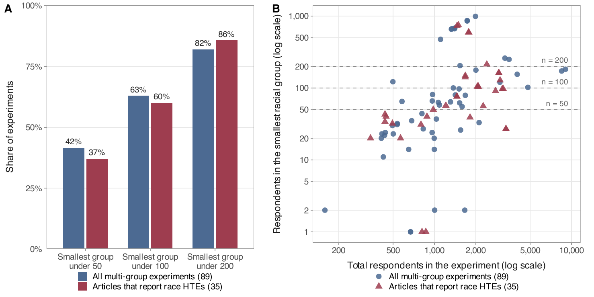
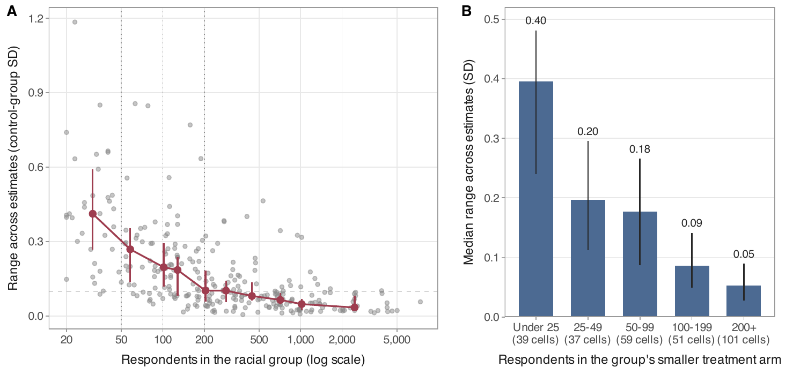
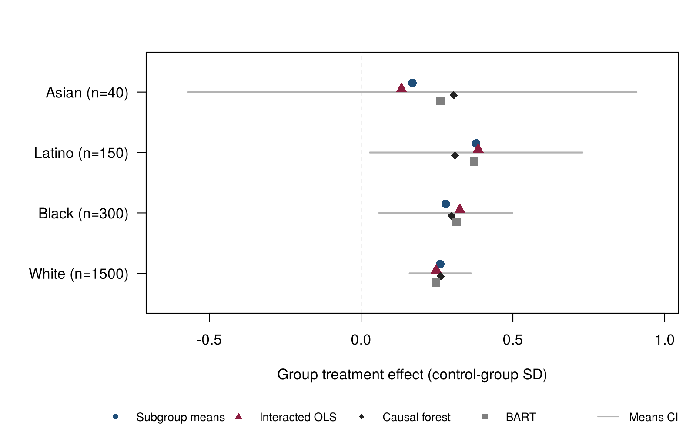

# htebalance (v0.1.0)

An R package for checking subgroup imbalance and comparing heterogeneous
treatment effect (HTE) estimates in randomized experiments.

This package goes with my paper, "Estimating Heterogeneous Treatment Effects
under Subgroup Imbalance."


### Why this package?

Political scientists often want to know whether treatment effects differ across racial and ethnic groups. But in practice, these groups are rarely equally represented in experimental samples. For example, an experiment may have hundreds of White respondents but only a few dozen Asian respondents. Once we split each group into treatment and control, the sample sizes become even smaller.

This creates two problems. First, smaller groups have fewer observations (**group size**), making their treatment effects harder to estimate precisely. Second, these groups make up a smaller share of the full sample (**group share**), so they may have less influence on models fitted using the full sample. As a result, the choice of estimation method can matter, especially for smaller groups.

This is not an unusual problem. In my review of race and ethnicity experiments published in the *APSR*, *AJPS*, and *JOP* since 2015, 42% of 89 experimental comparisons had at least one racial group with fewer than 50 respondents.

I developed `htebalance` to help researchers deal with these challenges. The package makes it easier to examine subgroup sizes and imbalance, compare different HTE estimators, and see how sensitive their results are to the methods they choose.



I then compared four estimators: subgroup means, interacted OLS, causal
forests, and BART. I used the same data and estimated the same group treatment
effects, changing only the estimator.

The estimates differed much more for smaller groups.



| Subgroup size | Median range across estimators |
|---|---|
| Fewer than 50 | 0.41 SD |
| 400 or more | 0.05 SD |

*Based on 287 group effects from 85 experimental comparisons. Effects are in
control-group SD units.*

This matters because researchers may reach different conclusions about the
same group depending on the estimator they use. A confidence interval from one
estimator does not tell us how much the estimate might change with another
method.

I made `htebalance` to help researchers check these issues in their own
experiments.

## Installation

```r
# install.packages("remotes")
remotes::install_github("SongeunEmilyLee/htebalance")
```

Causal forests require `grf`, and BART requires `dbarts`. Both are optional.

```r
install.packages(c("grf", "dbarts"))
```

## Example

The example uses simulated data.

### Step 1. Prepare the data

The data should have one row per respondent, with an outcome, a treatment
indicator (0/1), and a group variable.

```r
library(htebalance)

set.seed(10)
n <- c(White = 1500, Black = 300, Latino = 150, Asian = 40)
race <- rep(names(n), n)
age <- rnorm(sum(n), 45, 15)
treat <- unlist(lapply(n, function(m) sample(rep(0:1, length.out = m))))
effect <- c(White = 0.2, Black = 0.45, Latino = 0.3, Asian = -0.1)[race]
y <- 0.02 * (age - 45) + treat * effect + rnorm(sum(n))
data <- data.frame(y, treat, race, age)
```

### Step 2. Check subgroup imbalance

```r
diagnose_imbalance(data, "race", "treat", "y")
```

Example output:

```
  Group    N Share Treated Control Eff. n Per fold
  Asian   40  2.0%      20      20     40        8
 Latino  150  7.5%      75      75    150       30
  Black  300 15.1%     150     150    300       60
  White 1500 75.4%     750     750   1500      300
 Asian: small n, small share

  Group Estimate   SE        95% CI  MDE
  Asian     0.17 0.36 [-0.57, 0.91] 1.05
 Latino     0.38 0.18  [0.03, 0.73] 0.50
  Black     0.28 0.11  [0.06, 0.50] 0.31
  White     0.26 0.05  [0.16, 0.36] 0.14
```

For the Asian group, the minimum detectable effect (MDE) is about 1 SD at 80%
power. To check how many respondents would be needed to detect an effect of
0.2 SD, add `target_effect = 0.2`.

### Step 3. Compare estimators

```r
res <- compare_hte(data, "y", "treat", "race",
                   covariates = "age",
                   methods = c("means", "ols", "cf", "bart"))
res
```

Example output:

```
  Group    n Subgroup means Interacted OLS Causal forest BART Range
  Asian   40           0.17           0.13          0.30 0.26  0.17
 Latino  150           0.38           0.39          0.31 0.37  0.08
  Black  300           0.28           0.33          0.30 0.31  0.05
  White 1500           0.26           0.25          0.26 0.25  0.02
```

The range is the difference between the largest and smallest estimates. Here,
it is 0.17 for Asian respondents and 0.02 for White respondents. The function
also compares treatment effects between groups, using the largest group (here,
White respondents) as the reference group by default.

Without `grf` or `dbarts`, you can use `methods = c("means", "ols")`.

### Step 4. Plot the results

```r
plot(res)
plot(res, type = "contrasts")
```



The points show estimates from each method. Gray lines show 95% confidence
intervals for subgroup means only.

### Step 5. Get a short summary

```r
hte_report(res, groups = "Asian")
```

Example summary:

```
Asian: 40 respondents (2.0%), with 20 treated and 20 control.
Difference in means: 0.17 (SE 0.36, 95% CI -0.57 to 0.91).
MDE: 1.05 (power = 0.8, alpha = 0.05).
Across estimators: 0.13 to 0.30 (range 0.17).
```

## Functions

| Function | What it does |
|---|---|
| `diagnose_imbalance()` | Checks group sizes, shares, treatment allocation, standard errors, MDEs, and required sample sizes |
| `compare_hte()` | Compares group effects and between-group differences across estimators |
| `hte_report()` | Writes a short summary of the results |

## A few notes

- The package is designed for randomized experiments.
- Small group size and small group share are not the same thing, so the
  package reports both.
- Differences across estimators show how much the results depend on the method
  used. They do not tell us which estimator is more accurate, since we do not
  know the true treatment effects.
- The paper also introduces STAGE, which uses held-out error to choose weights
  for different estimators. STAGE is not included in this version of the
  package.

## Citation

Lee, Songeun Emily. "Estimating Heterogeneous Treatment Effects under Subgroup
Imbalance." Working paper.

## License

MIT
